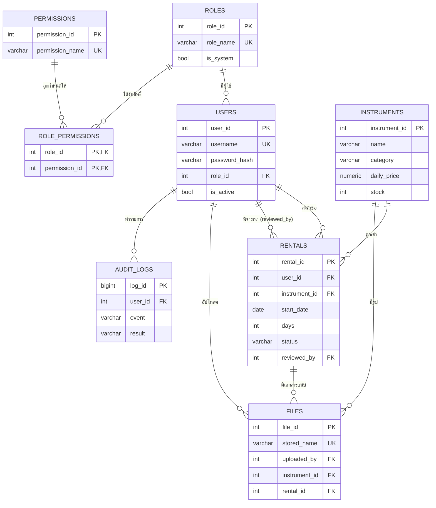

# จังหวะหัวใจ (Rhythm of the Heart) — ระบบเช่าเครื่องดนตรี

เว็บแอป Node.js + Express 5 + PostgreSQL + EJS  
ครบตามโจทย์: Authentication (bcrypt + Session), Role/Permission/ACL จัดการผ่านเว็บ, Middleware ตรวจสิทธิ์ฝั่ง Server,
Log ใน PostgreSQL พร้อมหน้าค้นหา, อัปโหลดไฟล์/ภาพตามสิทธิ์, API แยกส่วน Admin

## 1. ติดตั้งและเริ่มใช้งาน (Node.js 22+)

```bash
# 1) สร้างฐานข้อมูล (ครั้งเดียว)
psql -U postgres -h localhost -c "CREATE DATABASE instrument_rental;"

# 2) ติดตั้งแพ็กเกจ
npm install

# 3) ตั้งค่า
cp .env.example .env          # แก้ PGPASSWORD และ SESSION_SECRET
node -e "console.log(require('crypto').randomBytes(32).toString('hex'))"   # คัดลอกไปใส่ SESSION_SECRET

# 4) สร้างตาราง + ข้อมูลตัวอย่าง
npm run setup                 # = npm run init && npm run seed

# 5) เริ่มเซิร์ฟเวอร์
npm start                     # เปิด http://localhost:3000/login
```
เริ่มข้อมูลใหม่ทั้งหมด: `npm run reset` (ลบตารางแล้ว seed ใหม่) · ไฟล์ SQL สร้างฐานข้อมูล: `schema.sql`

## 2. บัญชีทดสอบ (แสดงบนหน้า Login คลิกเดียวเข้าสู่ระบบได้)

| Role | Username | Password | ทำอะไรได้ |
|---|---|---|---|
| admin | `admin` | `Admin123!` | ทุกฟังก์ชัน + จัดการผู้ใช้/Role/Permission/ACL/Log |
| manager | `manager01` | `Manager123!` | อนุมัติ/ปฏิเสธคำขอ, ดูรายการทั้งหมด, จัดการเครื่อง, ดู Log |
| staff | `staff01` | `Staff123!` | เพิ่ม/แก้ไขเครื่อง, ส่งมอบ/รับคืน, อัปโหลดรูป |
| customer | `customer01` | `Customer123!` | ส่งคำขอเช่า, ดู/ยกเลิกคำขอ **ของตนเอง**, แนบเอกสาร |
| customer | `customer02` | `Customer123!` | ใช้ทดสอบว่าเข้าดูรายการของ customer01 ไม่ได้ |

ปิดการแสดงบัญชีบนหน้า Login: ตั้ง `SHOW_DEMO_ACCOUNTS=false` ใน `.env`

## 3. Access Matrix (ตรงกับข้อมูล ACL ที่ seed)

| ทรัพยากร / การกระทำ (Permission) | Admin | manager | staff | customer |
|---|:-:|:-:|:-:|:-:|
| เครื่องดนตรี: ดู `instrument.read` | ✅ | ✅ | ✅ | ✅ |
| เครื่องดนตรี: เพิ่ม `instrument.create` | ✅ | ✅ | ✅ | – |
| เครื่องดนตรี: แก้ไข `instrument.update` | ✅ | ✅ | ✅ | – |
| เครื่องดนตรี: ลบ `instrument.delete` | ✅ | ✅ | – | – |
| คำขอเช่า: ส่งคำขอ `rental.create` | ✅ | – | – | ✅ |
| คำขอเช่า: ดูของตน `rental.read.own` | ✅ | – | – | ✅ (เฉพาะของตน) |
| คำขอเช่า: ดูทั้งหมด `rental.read.all` | ✅ | ✅ | ✅ | – |
| คำขอเช่า: ยกเลิกของตน `rental.cancel.own` | ✅ | – | – | ✅ (เฉพาะ pending ของตน) |
| คำขอเช่า: อนุมัติ/ปฏิเสธ `rental.approve` | ✅ | ✅ | – | – |
| คำขอเช่า: ส่งมอบ/รับคืน/ยกเลิก `rental.update_status` | ✅ | ✅ | ✅ | – |
| ไฟล์: อัปโหลด `file.upload` | ✅ | ✅ | ✅ | ✅ (แนบกับรายการของตนเท่านั้น) |
| ไฟล์: เปิดดู/ดาวน์โหลด `file.read` | ✅ | ✅ | ✅ | ✅ (ไฟล์รายการเช่าเฉพาะของตน) |
| ไฟล์: ลบ `file.delete` | ✅ | ✅ | – | – |
| ผู้ใช้ / Role / Permission / ACL (`user.manage` `role.manage` `permission.manage` `acl.manage`) | ✅ | – | – | – |
| Log `log.read` | ✅ | ✅ | – | – |
| รายงาน `report.view` (ยังไม่ seed — ใช้สาธิต) | ✅ | – | – | – |

**เงื่อนไขเจ้าของข้อมูล:** customer เห็น/ยกเลิก/แนบไฟล์ได้เฉพาะรายการที่ `user_id` เป็นของตน (ตรวจใน Route ทุกครั้ง)  
**Admin** ผ่านการตรวจสิทธิ์ทุกข้อ (รวม Permission ที่เพิ่มภายหลัง) และ Role `admin` ลบ/เปลี่ยนชื่อไม่ได้, ต้องมี Admin ที่ใช้งานได้อย่างน้อย 1 คน

## 4. ER Diagram


Cardinality: Role 1–N User · Role N–M Permission (ผ่าน `role_permissions` = ACL) · User 1–N Rental · Instrument 1–N Rental ·
Rental/Instrument 1–N File (ไฟล์ผูกกับอย่างใดอย่างหนึ่งเท่านั้น, CHECK constraint) · User 1–N AuditLog

## 5. โครงสร้างและลำดับ Middleware
`session → prepare (CSRF token, flash) → loadUser (โหลด User/Role/Permission จาก DB ทุกคำขอ) → csrfGuard`
→ Route group → `requireLogin` → `requirePermission('x')` → handler (ตรวจเจ้าของข้อมูลเพิ่มถ้าจำเป็น) → `writeLog`

| กลุ่ม | Path |
|---|---|
| ทั่วไป | `/login` `/logout` |
| ผู้ใช้ | `/app/...` (เครื่องดนตรี, การเช่า, ไฟล์, รายงาน) |
| Admin | `/admin/users` `/admin/roles` `/admin/permissions` `/admin/acl` `/admin/logs` |
| API | `/api/instruments` `/api/rentals` `/api/reports/summary` `/api/admin/{users,roles,acl,logs}` |

เหตุผลที่ใช้ **Session** (express-session): ฝั่ง Server ควบคุม/ทำลายสถานะได้ทันทีตอน Logout, Cookie เป็น HttpOnly + SameSite=Lax  
รหัสผ่านเก็บด้วย **bcrypt** (มี Salt ในตัว) · ฟอร์ม POST ทุกฟอร์มมี CSRF token

## 6. สคริปต์สาธิต (ตรงกับ 9 หลักฐานในโจทย์)

1. **กระบวนการหลัก:** `customer01` เปิด "เครื่องดนตรี" → เช่าเลย → ส่งคำขอ → `manager01` อนุมัติ → `staff01` ส่งมอบ → รับคืน (ดูสถานะที่หน้ารายการเช่า)
2. **4 Role ต่างกัน:** คลิกบัญชีทดสอบบนหน้า Login ทีละบัญชี แล้วเทียบเมนูที่เห็น
3. **Admin ทำได้ทุกอย่าง:** `admin` เข้าเมนู ผู้ใช้ / Role / Permission / ACL / Log
4. **ถูกปฏิเสธ:** login `customer01` แล้วพิมพ์ `/admin/users` → 403 · เปิด `/api/admin/users` → JSON 403 · เปิด `/app/rentals/<id ของ customer02>` → 403
5. **เพิ่ม Role ใหม่:** `/admin/roles` เพิ่ม `technician` → `/admin/users` แก้ไข `customer02` เปลี่ยน Role เป็น `technician`
6. **เพิ่ม Permission:** `/admin/permissions` เพิ่ม `report.view` (ป้ายเขียวว่าเชื่อมกับฟังก์ชันแล้ว) → `/admin/acl` ติ๊กให้ `technician` → บันทึก → login เป็น customer02 จะเห็นเมนู "รายงาน" และเปิด `/api/reports/summary` ได้  
   (ลองเพิ่ม `equipment.export` เพื่อดูป้ายเหลือง "ยังไม่มีโค้ดใช้งาน")
7. **ยกเลิก Permission:** `/admin/acl` เอาติ๊ก `report.view` ของ `technician` ออก → รีเฟรช: หน้า `/app/reports` และ `/api/reports/summary` ถูกปฏิเสธทันที (ไม่ต้องรีสตาร์ต)
8. **ไฟล์:** `customer01` เปิดรายการเช่าของตน → แนบ JPG/PNG/PDF (เปิดดู/ดาวน์โหลดได้) → ลองแนบไฟล์ `.txt` หรือไฟล์เกิน 2 MB (ถูกปฏิเสธ) → login `customer02` เปิด `/app/files/<id>` ของ customer01 → 403 · `staff01` อัปโหลดรูปเครื่องดนตรีที่หน้ารายละเอียดเครื่อง
9. **Log:** `/admin/logs` กรองตามวันที่/ผู้ใช้/เหตุการณ์ เช่น `role.create`, `acl.grant`, `acl.revoke`, `file.upload`, `access.denied`

## 7. ความปลอดภัยที่ทำไว้
- ตรวจสิทธิ์ฝั่ง Server ทุก Route/API (การซ่อนเมนูเป็นแค่ UX) · สิทธิ์อ่านจากฐานข้อมูลทุกคำขอ จึงเปลี่ยน Role/ACL แล้วมีผลทันที
- อัปโหลด: จำกัดขนาด (`MAX_UPLOAD_MB`), ตรวจชนิดจาก magic bytes (JPG/PNG/WebP/PDF), ตั้งชื่อไฟล์เป็น UUID, เก็บนอกโฟลเดอร์ public, เปิดผ่าน Route ที่ตรวจสิทธิ์เท่านั้น
- Log ไม่บันทึกรหัสผ่าน/Session ID/Token · Query ทั้งหมดใช้ parameter ($1, $2) · EJS escape ผลลัพธ์ทุกจุด

## 8. ข้อจำกัด (ควรบอกในสไลด์)
Session เก็บในหน่วยความจำ (รีสตาร์ตแล้วต้องล็อกอินใหม่ — ใช้ `connect-pg-simple` ได้หากต้องการถาวร) · ไม่มี Rate limit ที่หน้า Login ·
การจองสต็อกตัดตอนอนุมัติ · ไม่มีระบบชำระเงินจริง
